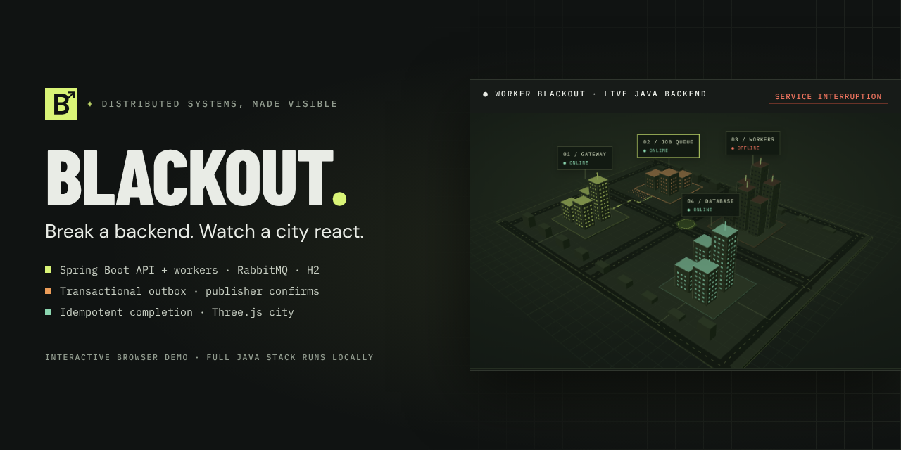
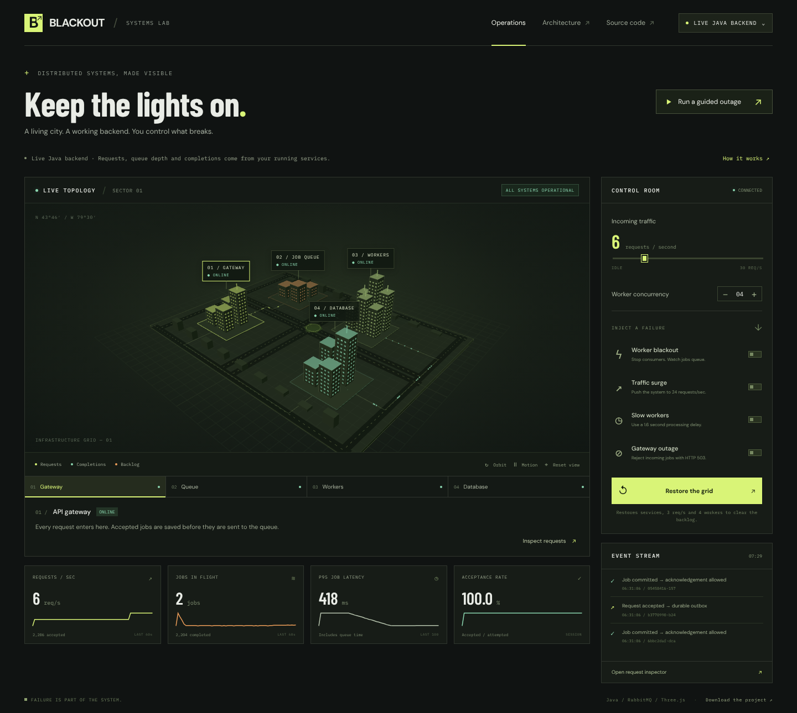
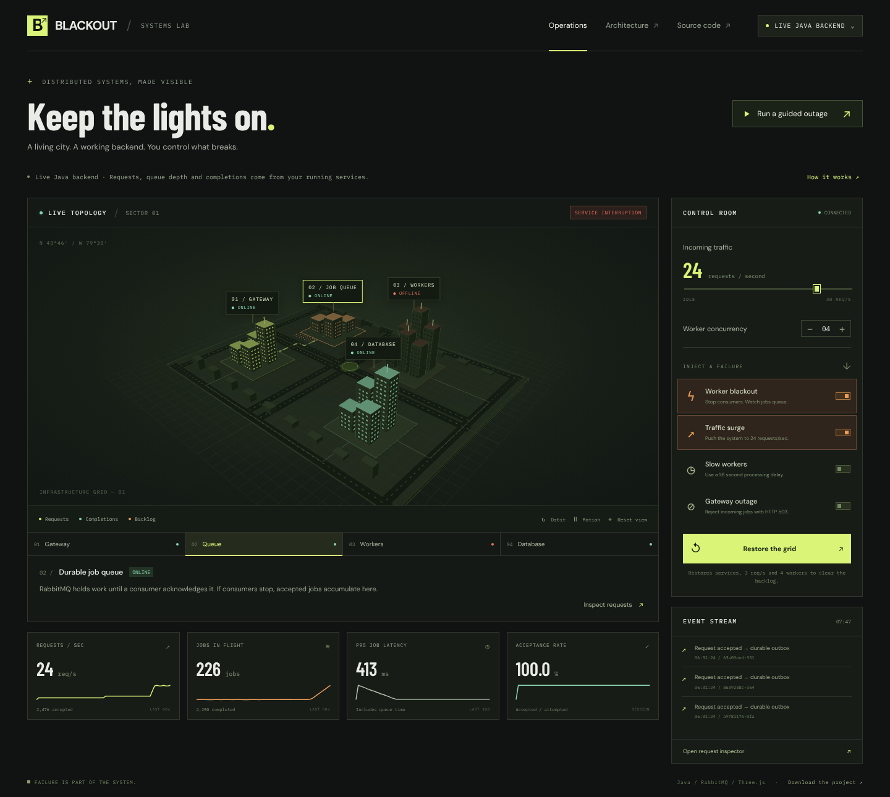
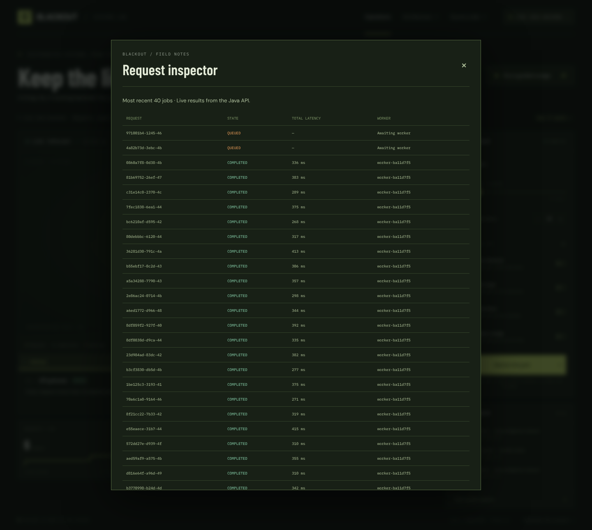
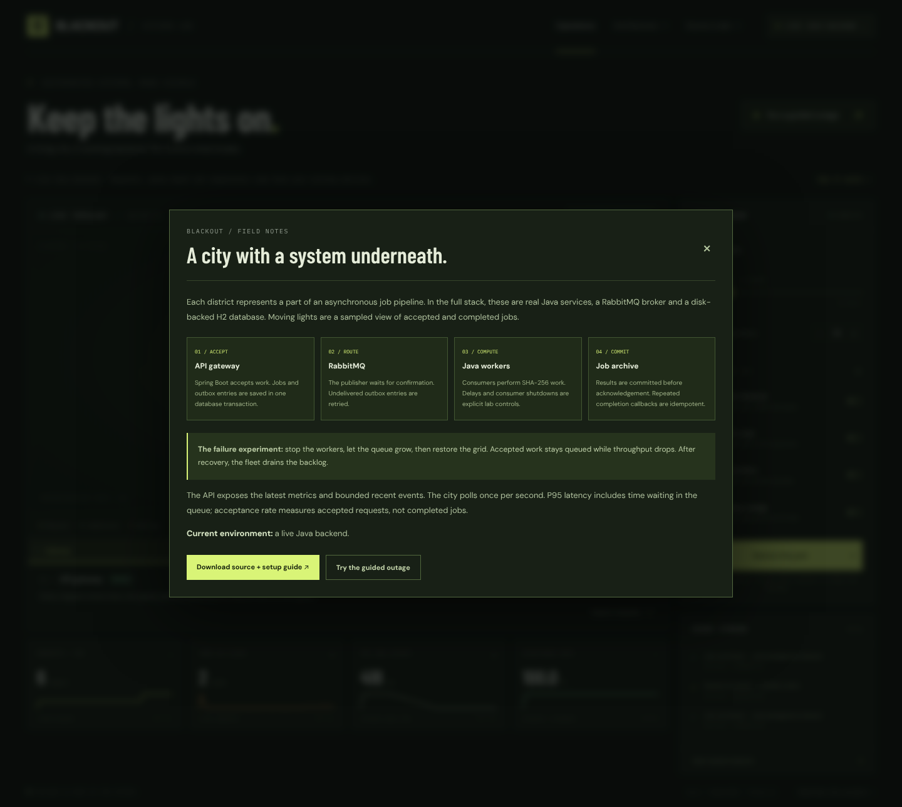
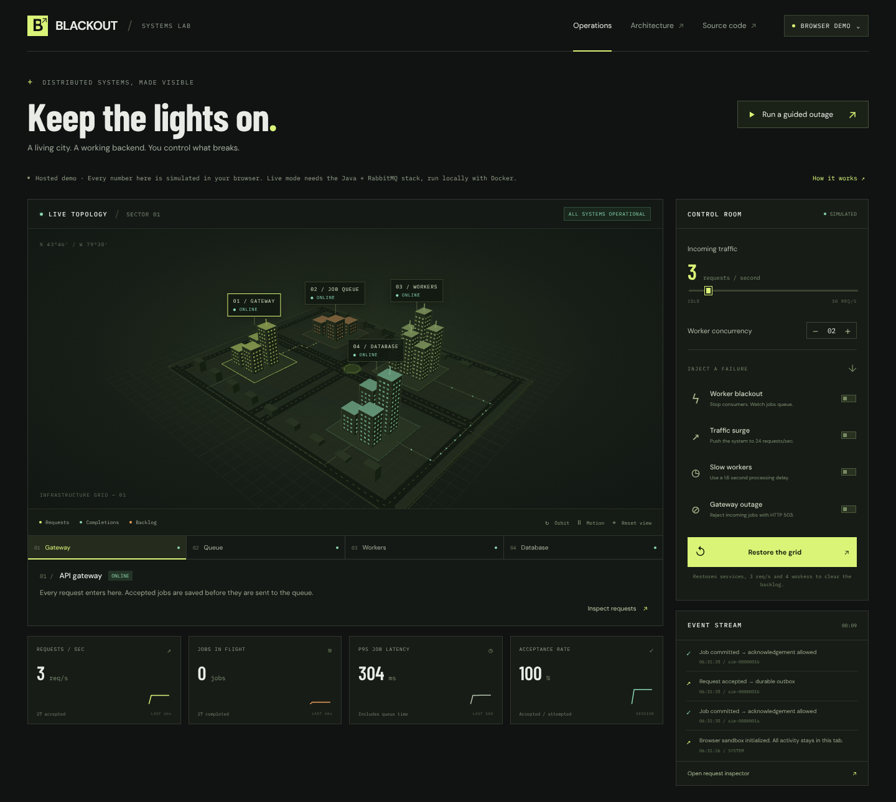
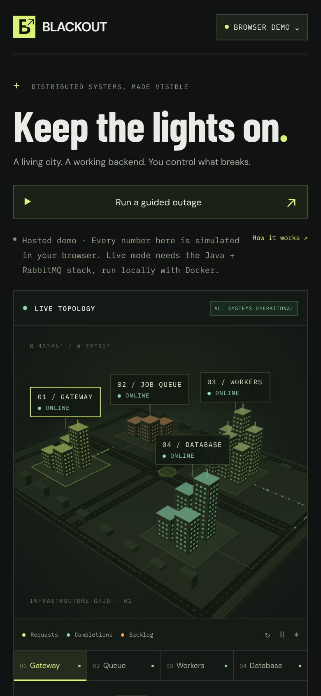
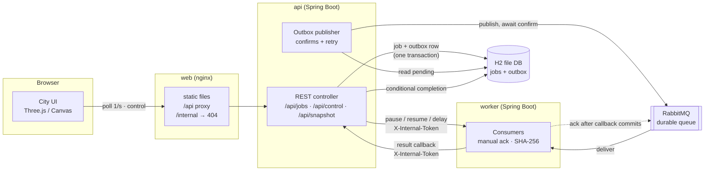

<p align="center">
  
</p>

<p align="center">
  <strong>An asynchronous job pipeline you can break on purpose, rendered as a living 3D city.</strong><br>
  <sub>Java 17 · Spring Boot 3.5 · RabbitMQ · H2 · Three.js · Vite · Docker Compose · MIT</sub><br>
  <sub>Created by <b>Nima Memarahari</b> (<a href="https://github.com/NimaMema">@NimaMema</a>)</sub>
</p>

---

## In 30 seconds

BLACKOUT turns a real distributed-systems pattern into something you can see and poke. A Spring Boot API accepts jobs and writes them, with an outbox record, in one database transaction. A publisher pushes them to RabbitMQ with confirmations. Java workers consume them, do real SHA-256 work, and report results before acknowledging. Each part of that pipeline is a district in a 3D city. Requests are moving lights, an outage darkens a district, and queued work piles up as an orange backlog that drains when consumers come back.

The interesting part is what *doesn't* go wrong. Stop the workers and accepted jobs stay queued. Replay a request and you get the same job back. Crash between "result saved" and "message acknowledged", and the redelivery won't be double-counted.

| | |
| --- | --- |
| **Try it, no install** | **[Open the browser demo](https://nimamema.github.io/blackout-grid-public/)**. It runs a deterministic simulation of the pipeline in your tab, and it's labelled as a simulation. *(The link works once GitHub Pages is enabled; see [Deploying the browser demo](#deploying-the-browser-demo).)* |
| **Run the real stack** | `docker compose up --build`, then open <http://localhost:3000>. The header reads **LIVE JAVA BACKEND** (see [Quick start](#quick-start)). |
| **Read the interesting part** | [Delivery guarantees](#delivery-guarantees): why confirmations, persistence and idempotency are needed together. |

<p align="center">
  <br>
  <sub>Connected to the live Java backend: real requests, real queue depth, real completions.</sub>
</p>

## Simulated vs. real: what runs where

BLACKOUT has two modes, and the interface always says which one you're in. The header shows **BROWSER DEMO** or **LIVE JAVA BACKEND**, a note under the title explains it, and the Control Room shows **SIMULATED** or **CONNECTED**. If the Java connection drops, it keeps the last real snapshot and says *disconnected*. It never quietly switches to simulated numbers.

| Capability | Browser demo (GitHub Pages / `npm run dev`) | Live Java backend (Docker Compose) |
| --- | --- | --- |
| 3D city, district selection, orbit, motion pause, Canvas fallback | ✅ Same UI | ✅ Same UI |
| Traffic slider, worker concurrency, the four failure switches, guided outage | ✅ Drives an in-tab model | ✅ Drives real services through `POST /api/control` |
| Requests/sec, jobs in flight, P95 latency, acceptance rate | 🟡 **Simulated** by `src/simulation.js` (deterministic, tested) | ✅ Measured by the Java API |
| Job queue and backlog | 🟡 Simulated array in the browser | ✅ Durable RabbitMQ queue with manual acks |
| Job work | 🟡 Simulated timing only, no hashing | ✅ 8,000 chained SHA-256 rounds in a Java worker |
| Persistence across restarts | ❌ Reload starts a fresh sandbox | ✅ H2 on a Docker volume (jobs + outbox) |
| Transactional outbox, publisher confirms, outbox retry | ❌ Not modelled | ✅ Implemented and unit-tested |
| `Idempotency-Key` deduplication, idempotent completion | 🟡 Duplicate keys modelled | ✅ Enforced by the database, smoke-tested |
| HTTP 503 on gateway outage | 🟡 Counted as a rejected attempt | ✅ Real HTTP 503 from the API |
| Request inspector | 🟡 Simulated job IDs (`sim-…`), worker `browser-model` | ✅ Real job UUIDs, worker IDs and SHA-256 results |

The GitHub Pages build (`npm run build:pages`) goes further. It has no Java API on its origin, so it hides the "connect" option, links to this repository instead of the source zip, and states that every number is simulated.

## Screenshots

<table>
<tr>
<td width="50%"><br><sub><b>Worker blackout + traffic surge</b> (live backend): consumers stopped, 200+ accepted jobs waiting in RabbitMQ.</sub></td>
<td width="50%"><br><sub><b>Request inspector</b> (live backend): job IDs, end-to-end latency and the worker that processed each one.</sub></td>
</tr>
<tr>
<td><br><sub><b>Field notes</b>: each district maps to one stage of the pipeline.</sub></td>
<td><br><sub><b>Hosted demo</b>: the same interface, clearly labelled as an in-browser simulation.</sub></td>
</tr>
</table>

<p align="center"><br><sub>Responsive down to phone width, with keyboard-accessible controls and reduced-motion support.</sub></p>

## Architecture



### Delivery guarantees

- **Accept → persist.** A job and its outbox record are saved in one H2 transaction, so the API never accepts work it hasn't stored.
- **Persist → publish.** The outbox publisher waits for a RabbitMQ publisher confirmation before marking a record published. Unconfirmed records are retried.
- **Consume → commit → ack.** The worker's result callback is committed to H2 *before* the RabbitMQ acknowledgement. A crash between the two can cause redelivery. The completion update only applies `WHERE completed_at IS NULL`, so a redelivered result can't be counted twice.
- **Duplicate submissions.** An `Idempotency-Key` header maps repeated submissions, including concurrent ones, to the same job.

The result is **at-least-once delivery with idempotent completion**, not an exactly-once transport. If the API crashes after RabbitMQ confirms a publish but before the outbox row is marked, that job is published again after restart, and the same idempotent completion path absorbs it.

## Tech stack

| Layer | Technology |
| --- | --- |
| Frontend | Vanilla ES modules, [Three.js](https://threejs.org/) r180 WebGL renderer with a hand-written Canvas 2D fallback, Vite 6 |
| API | Java 17, Spring Boot 3.5 (Web, JDBC, Validation, AMQP), H2 file database |
| Worker | Java 17, Spring Boot 3.5, Spring AMQP listener containers with manual acknowledgements |
| Messaging | RabbitMQ 4.1 (durable queue, persistent messages, publisher confirms) |
| Ops | Docker Compose (four services, loopback-only ports, named volumes, health checks), nginx |
| Quality | `node:test` model tests, JUnit 5 + Mockito, a Python HTTP smoke test against the real stack, GitHub Actions |

## Quick start

### Full stack (Docker)

Install [Docker Desktop](https://www.docker.com/products/docker-desktop/) and start it. On Windows, finish Docker Desktop's WSL 2 setup if it asks you to.

```bash
git clone https://github.com/NimaMema/blackout-grid-public.git
cd blackout-grid-public
docker compose up --build
```

The first run downloads dependencies and builds the Java services and the frontend. When it's ready, open **<http://localhost:3000>**. The header should read **LIVE JAVA BACKEND**. RabbitMQ's management UI is at <http://localhost:15672>.

Stop with Ctrl+C, then:

```bash
docker compose down
```

Named volumes keep the database and broker state between runs. No paid services, API keys or cloud accounts are needed.

### Browser demo only

With Node.js 20.19+:

```bash
npm ci
npm run dev
```

This starts in browser demo mode. Vite proxies `/api` to `localhost:8080`, so if the Java services are running you can switch to live mode from the environment menu, or by appending `?live=1`.

### Java services without Docker

With JDK 17+ and Maven 3.6.3+:

```bash
docker compose up -d rabbit
mvn -f server/pom.xml package
java -jar server/api/target/api-1.0.0.jar
```

In a second terminal:

```bash
java -jar server/worker/target/worker-1.0.0.jar
```

The API listens on `localhost:8080`, the worker on `localhost:8081`, and the broker on `localhost:5672`.

### Configuration

A local run needs no configuration. The stack ships with **development-only defaults**, which are only safe because every published port binds to `127.0.0.1`. To override them, copy `.env.example` to `.env` (git-ignored) and edit it:

| Variable | Used by | Default (local only) | Purpose |
| --- | --- | --- | --- |
| `BLACKOUT_INTERNAL_TOKEN` | API, worker | `local-development-only` | Shared secret for API ↔ worker `/internal/*` calls |
| `RABBITMQ_USER` | broker, API, worker | `blackout` | RabbitMQ username |
| `RABBITMQ_PASS` | broker, API, worker | `local-lab-only` | RabbitMQ password |
| `BLACKOUT_DB_URL` | API | H2 file in `./data` | JDBC URL for the job database |
| `BLACKOUT_WORKER_URL` / `BLACKOUT_API_URL` | API / worker | `http://localhost:8081` / `:8080` | Service-to-service addresses |

When running the Java services outside Docker, export the same variables in your shell instead.

## Try the experiment

1. Click **Worker blackout**. Consumers stop taking new jobs, though work already in progress can finish.
2. Turn up the traffic, or enable **Traffic surge** (24 req/s).
3. Watch the orange backlog, the completed count and the request inspector.
4. Click **Restore the grid**. Four consumers come back and drain the queue.
5. Try **Gateway outage** to see real HTTP 503 rejections in live mode, or **Slow workers** to watch P95 latency climb.

**Run a guided outage** automates a 26-second version of this.

### What the metrics mean

| Metric | Meaning |
| --- | --- |
| Requests/sec | Newly accepted distinct jobs in the last sample interval |
| Jobs in flight | Accepted jobs minus committed completions, including outbox, broker and processing |
| P95 job latency | 95th percentile end-to-end latency over the last 100 completed jobs, including queue time |
| Acceptance rate | Accepted submission attempts divided by all attempts in this API session |

Moving lights are a sampled picture of throughput, not a one-to-one packet capture.

## Testing and verification

```bash
npm test                       # browser-model tests (node:test)
npm run build                  # production frontend (Docker / same-origin API)
npm run build:pages            # static GitHub Pages demo
node scripts/check-pages.mjs   # checks every asset reference in the Pages build
mvn -f server/pom.xml verify   # Java unit tests
python3 scripts/smoke.py       # against a running stack (add --url http://localhost:8080 without nginx)
```

On Windows, use `python` instead of `python3` if that's your Python launcher.

The smoke test drives the real stack over HTTP. It checks idempotent submission, a completed SHA-256 job, that all eight jobs survive a consumer outage and drain on recovery, and that the gateway outage returns HTTP 503 and recovers.

GitHub Actions runs two workflows. **Verify BLACKOUT** (`ci.yml`) runs the model tests, the Java tests, the Docker Compose build and the smoke test. **GitHub Pages demo** (`pages.yml`) builds and checks the static demo. The latest recorded results are in [docs/VALIDATION.md](docs/VALIDATION.md).

## Deploying the browser demo

`.github/workflows/pages.yml` builds the static demo on every pull request and push to `main`, but **only deploys when you run it by hand**:

1. In **Settings → Pages**, set *Source* to **GitHub Actions**.
2. In **Actions → GitHub Pages demo**, choose **Run workflow** on `main`.

The site is served at `https://nimamema.github.io/blackout-grid-public/`. The Pages build contains only static files and the source zip, with no Java services. If you rename the repository, update `base` in `vite.config.js` and `REPO_URL` in `src/main.js`.

## Security notes

- **The control API is deliberately open.** `POST /api/control` and `POST /api/jobs` have no user authentication, because the point of the lab is to let the person at the keyboard break things. **Don't expose the Java stack to the internet or a shared network as it is.** If you need to, put it behind authentication and replace every default in `.env` with a strong, unique value (for example `openssl rand -hex 32`).
- `/internal/*` endpoints require `BLACKOUT_INTERNAL_TOKEN` (compared in constant time) and are blocked at the nginx proxy.
- The RabbitMQ management UI (`127.0.0.1:15672`) uses the RabbitMQ credentials above.
- `npm run dev` and `npm run preview` listen on `localhost` only. Opt in to LAN access with `npm run dev -- --host`.
- The **Download source** archive is built from an explicit allowlist in `scripts/bundle.py`. Hidden files, `.env` files, keys, symlinks and unknown file types are never packaged.
- Report security issues privately to the maintainer, not in a public issue.

## Limitations

These are deliberate scope boundaries, not hidden caveats:

- **Single API instance.** H2 is owned by one API process. Multiple replicas would need a shared database and coordination between outbox publishers.
- **At-least-once, not exactly-once.** Duplicates are absorbed by idempotent completion. They aren't prevented at the transport.
- **No authentication on the lab controls** (see Security notes). This is a local teaching and demo tool, not a production job system.
- **Not a benchmark.** No throughput or latency figures are claimed. The numbers on screen depend on your machine and a deliberately small unit of work.
- **Polling, not streaming.** The UI polls a snapshot once per second. Snapshots carry bounded history: the latest 40 jobs, P95 over the last 100 completions, 60 one-second samples and 80 events.
- **The browser demo is a model.** It mirrors the pipeline's behaviour (queueing, consumer stop, gateway rejection, recovery) but not the outbox, confirmations or persistence.
- **External fonts.** The UI loads its fonts from Google Fonts, so visitors' browsers contact `fonts.googleapis.com`.

## Repository map

| Path | Purpose |
| --- | --- |
| `src/main.js` | UI, backend adapter, controls, guided outage and hosted-demo behaviour |
| `src/city.js` · `src/city-canvas.js` | Three.js renderer and the interactive Canvas fallback |
| `src/simulation.js` | Deterministic, tested browser model |
| `server/api` | REST API, persistence, outbox publisher, traffic generator and metrics |
| `server/worker` | RabbitMQ consumers, SHA-256 work and token-protected controls |
| `server/shared` | Message contracts and queue declaration |
| `docker/` · `compose.yaml` | nginx proxy, Java image builds and the four-service stack |
| `scripts/` | Smoke test, source bundler, Pages build check and screenshot capture |
| `docs/` | Validation record, demo script, screenshots and portfolio assets |

## Credits and licenses

- Created and maintained by **Nima Memarahari** ([@NimaMema](https://github.com/NimaMema)). It's a companion to [BLACKGUARD](https://github.com/NimaMema/blackguard), a local-first security monitoring platform.
- BLACKOUT is released under the [MIT License](LICENSE).
- Third-party components (three.js, Spring Boot, RabbitMQ, H2 and the Google Fonts typefaces) keep their own licenses. See [THIRD_PARTY_NOTICES.md](THIRD_PARTY_NOTICES.md). Only three.js (MIT) is redistributed, inside the built frontend.
- The favicon, screenshots and social images are original to this project. Regenerate them with `node scripts/capture-screenshots.mjs`.
