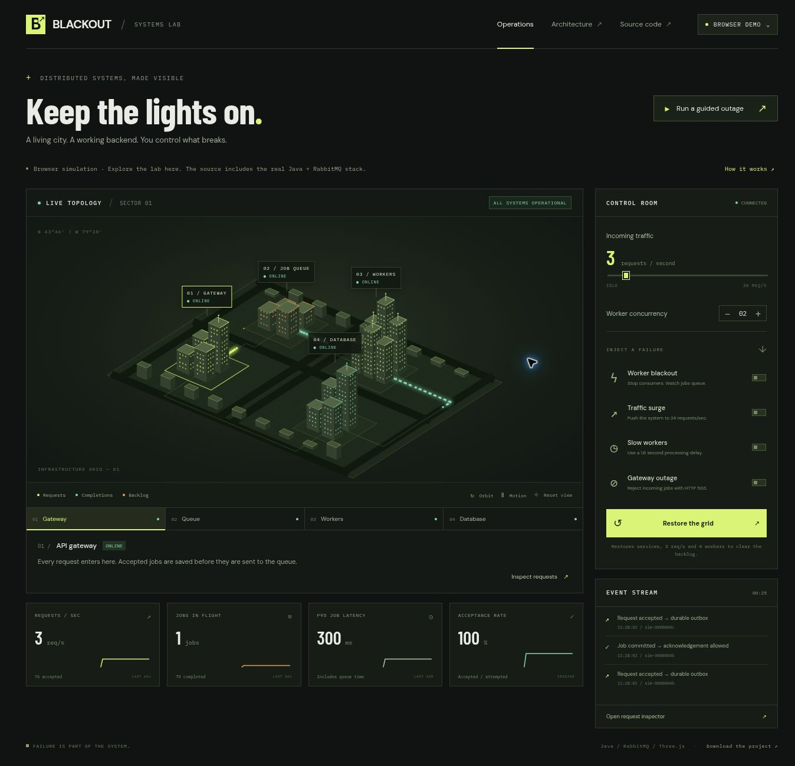

# BLACKOUT

**Break a backend. Watch a city react.**

BLACKOUT turns an asynchronous job pipeline into an explorable city. Requests become moving lights. Worker outages darken a district. Queued work accumulates, then drains when consumers recover.

It has two explicit modes:

| Mode | What runs |
| --- | --- |
| Browser demo | A deterministic simulation in the tab. No external services or API keys. |
| Live Java backend | Two Spring Boot processes, RabbitMQ, a disk-backed H2 database, and the same city interface. |

The interface always labels its environment. Losing the Java connection preserves the last real snapshot; it does not switch to simulated numbers.

## Run the full project

Install [Docker Desktop](https://www.docker.com/products/docker-desktop/) and start it. On Windows, complete Docker Desktop's WSL 2 setup if prompted.

Open a terminal in this folder:

~~~sh
docker compose up --build
~~~

The first run downloads dependencies and builds the Java services and frontend. Once the services are ready, open **http://localhost:3000**. The header should read **LIVE JAVA BACKEND**.

No paid services, AI API keys, or cloud accounts are required.

Stop the stack with Ctrl+C, then:

~~~sh
docker compose down
~~~

Named Docker volumes retain the database and broker state between runs. The supplied ports bind to localhost. This is an intentionally controllable local lab; its credentials are development defaults.

## Configuration

No configuration is required for a local run. The stack ships with **development-only defaults** that are safe only because every published port binds to `127.0.0.1`.

To override them, copy the template and edit it. Docker Compose reads `.env` automatically. `.env` is git-ignored, so never commit it.

~~~sh
cp .env.example .env
~~~

| Variable | Used by | Default (local only) | Purpose |
| --- | --- | --- | --- |
| `BLACKOUT_INTERNAL_TOKEN` | API, worker | `local-development-only` | Shared secret for the API ↔ worker `/internal/*` calls |
| `RABBITMQ_USER` | broker, API, worker | `blackout` | RabbitMQ username |
| `RABBITMQ_PASS` | broker, API, worker | `local-lab-only` | RabbitMQ password |
| `BLACKOUT_DB_URL` | API | H2 file in `./data` | JDBC URL for the job database |
| `BLACKOUT_WORKER_URL` / `BLACKOUT_API_URL` | API / worker | `http://localhost:8081` / `:8080` | Service-to-service addresses |

When running the Java services outside Docker, export the same variables in your shell instead.

The browser demo (the static frontend) needs no configuration or keys.

## Security notes

- **The control API is open by design.** `POST /api/control` and `POST /api/jobs` have no user authentication, because the lab's purpose is to let the person at the keyboard break things. Do **not** expose the Java stack to the internet or a shared network as is. If you do, put it behind authentication and replace every default in `.env` with a strong, unique value (for example, `openssl rand -hex 32`).
- `/internal/*` endpoints require `BLACKOUT_INTERNAL_TOKEN` and are blocked at the nginx proxy.
- The RabbitMQ management UI (`127.0.0.1:15672`) uses the RabbitMQ credentials above.
- `npm run dev` and `npm run preview` listen on `localhost` only. To test from another device on a trusted network, opt in with `npm run dev -- --host`. The Vite dev server is never used in the Docker or static production builds.
- The **Download source** archive is built from an explicit allowlist in `scripts/bundle.py`. Hidden files, `.env` files, keys, symlinks and unknown file types are never packaged; add new file types there deliberately.
- Report security issues privately to the maintainer rather than in a public issue.

## Try the experiment

1. Click **Worker blackout**. Consumer containers stop accepting jobs; their current work can finish.
2. Increase incoming traffic, or enable **Traffic surge**.
3. Inspect the orange backlog, completed count, and request table.
4. Click **Restore the grid**. Four consumers resume processing and drain the queue.
5. Try **Gateway outage** to observe actual HTTP 503 job rejections in Java mode.

The guided outage automates a short version of this experiment.

## What is implemented

- An orbitable city, service selection, camera reset, and a motion pause.
- A Three.js WebGL renderer, with an interactive Canvas renderer when WebGL is unavailable.
- Live traffic, concurrency, consumer shutdown, gateway rejection, and injected processing delays.
- A transactional outbox: each accepted job and its delivery record are saved together.
- Publisher confirmations and retry of unconfirmed outbox entries.
- Durable RabbitMQ messages and manual consumer acknowledgements.
- Deterministic Java SHA-256 work, followed by a result callback and acknowledgement.
- Idempotent submissions and completion updates, including concurrent retries.
- One-second snapshots, bounded event history, sparklines, and a request inspector.
- A responsive UI, keyboard-accessible district controls, and reduced-motion support.
- Java tests, browser-model tests, a real-stack smoke test, and GitHub Actions.

## Architecture

~~~mermaid
flowchart TD
  UI["City interface"] --> API["Java API"]
  API --> DB["H2 jobs and outbox"]
  API --> MQ["RabbitMQ"]
  MQ --> W["Java worker"]
  W --> API
~~~

The worker's result callback is committed to H2 before its RabbitMQ acknowledgement. A crash between those operations can cause redelivery. The database's conditional completion update prevents double counting. This is **at-least-once delivery with idempotent completion**, rather than an exactly-once transport.

If the API crashes after RabbitMQ confirms a publish but before the outbox is marked, it can publish that job again after restart. The same idempotent completion path handles the duplicate.

H2 is deliberately owned by the single API instance. It is persisted to a Docker volume. Multiple API replicas would require a shared database and coordination for outbox publishers; this version supports one API instance.

## Local frontend development

With Node.js 20.19+:

~~~sh
npm ci
npm run dev
~~~

Open the address printed by Vite. It starts in browser demo mode. Vite proxies /api to localhost:8080 if you connect the Java backend through the environment menu.

The download link is generated with Python 3:

~~~sh
npm run bundle
npm run build
~~~

Docker generates this bundle automatically during its frontend build.

For Java development, use JDK 17+ and Maven 3.6.3+:

~~~sh
docker compose up -d rabbit
mvn -f server/pom.xml package
java -jar server/api/target/api-1.0.0.jar
~~~

In a second terminal:

~~~sh
java -jar server/worker/target/worker-1.0.0.jar
~~~

Start Vite, open the environment menu, and connect to the same-origin API. Alternatively, append ?live=1 to the local Vite URL. The API listens on localhost:8080, the worker on localhost:8081, and the broker on localhost:5672.

## Verify

~~~sh
npm test
npm run build
mvn -f server/pom.xml verify
~~~

With the full stack running, exercise actual HTTP requests and queue processing:

~~~sh
python3 scripts/smoke.py
~~~

On Windows, use python instead of python3 if that is your Python launcher.

The smoke test checks idempotency, completed work, consumer outage retention, recovery, and gateway rejection. It leaves traffic at 3 requests/sec with four consumers.

GitHub Actions runs the same Java and browser tests, builds the Docker stack, and runs the smoke test on every push or pull request. No passing CI badge or benchmark is claimed before a run.

## Important metrics

| Metric | Meaning |
| --- | --- |
| Requests/sec | Newly accepted distinct jobs in the last sample interval |
| Jobs in flight | Accepted jobs minus committed completions; includes outbox, broker and processing |
| P95 job latency | 95th percentile of end-to-end latency for the last 100 completed jobs |
| Acceptance rate | Accepted submission attempts divided by all submission attempts in this API session |

P95 includes queue waiting. Stopping workers can leave the last completed-job latency visible until new jobs complete. Moving lights are sampled representations of throughput, not a one-to-one packet capture.

## Repository map

| Path | Purpose |
| --- | --- |
| src/main.js | UI, backend adapter, controls and walkthrough |
| src/city.js | Three.js renderer |
| src/city-canvas.js | Canvas fallback with projection, drag and zoom |
| src/simulation.js | Deterministic, tested browser model |
| server/api | REST API, persistence, outbox, traffic generation and metrics |
| server/worker | RabbitMQ consumers, actual work and authenticated controls |
| server/shared | Message contracts and queue declaration |
| docker | Production frontend proxy and Java image builds |
| scripts/smoke.py | Integration checks against a running stack |
| docs/DEMO.md | A short recording plan for a portfolio demo |

## Put it on GitHub

Create an empty repository named blackout. In this folder, run:

~~~sh
git init
git status --ignored   # confirm .env, data/, target/, node_modules/ and public/downloads/ are ignored
git add .
git commit -m "Build BLACKOUT infrastructure city"
git branch -M main
~~~

Add the remote URL GitHub displays for your new repository, then push main. You can also use VS Code's **Publish to GitHub** action after signing in.

Before presenting the project, read through the queue and failure paths and run the experiment yourself. The interesting interview discussion is why confirmations, persistence, and idempotency are needed together.

## Third-party components

| Component | License |
| --- | --- |
| [three.js](https://github.com/mrdoob/three.js) | MIT |
| [Vite](https://github.com/vitejs/vite) (build only) | MIT |
| Spring Boot, Spring AMQP | Apache 2.0 |
| H2 Database | MPL 2.0 / EPL 1.0 |
| RabbitMQ (Docker image) | MPL 2.0 |
| Barlow Condensed, DM Sans, IBM Plex Mono (loaded from Google Fonts) | SIL Open Font License 1.1 |

The favicon and the preview screenshot are original to this project. The fonts are loaded from Google's servers at runtime, so visitors' browsers contact `fonts.googleapis.com`.

## License

MIT. See LICENSE.
